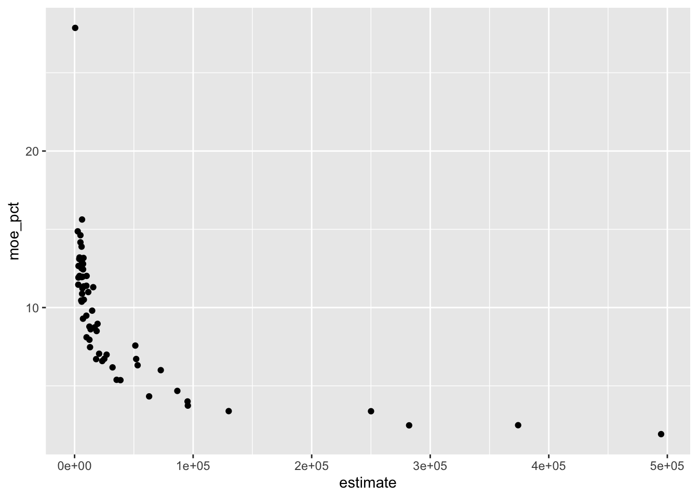
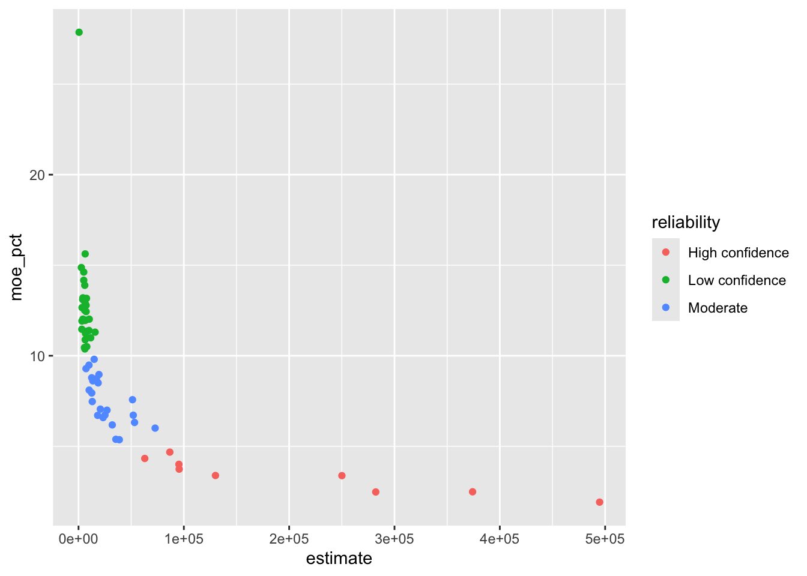
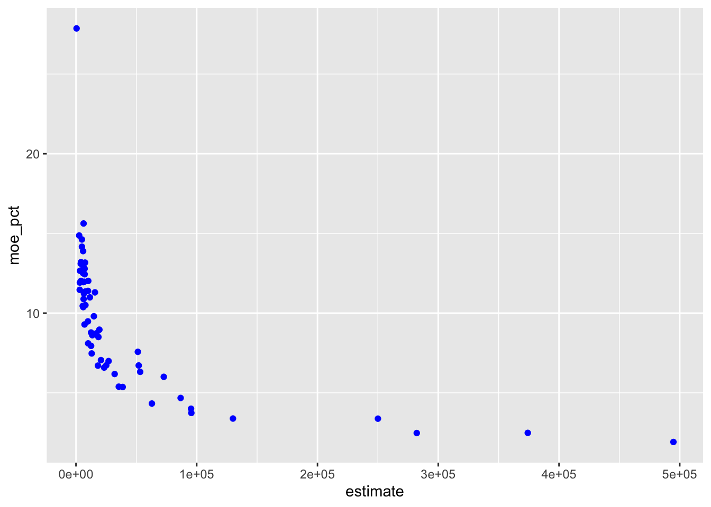
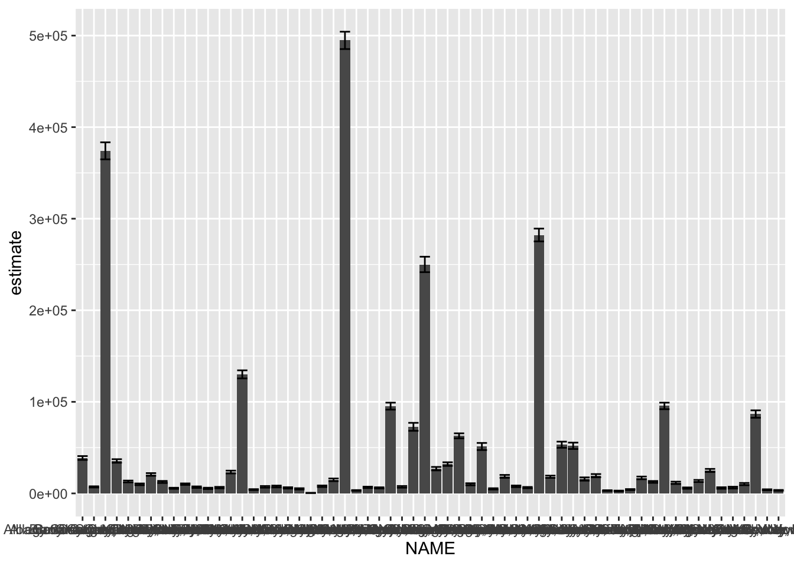
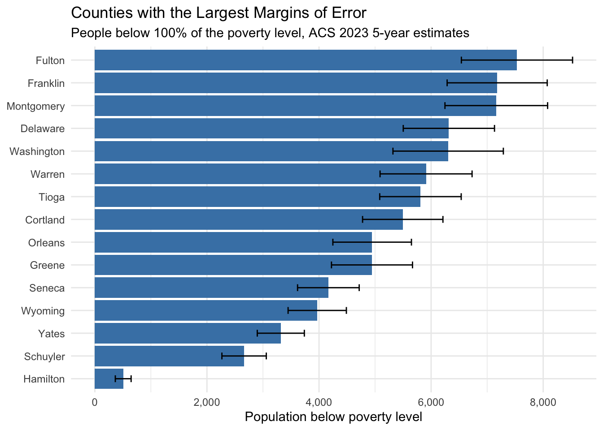
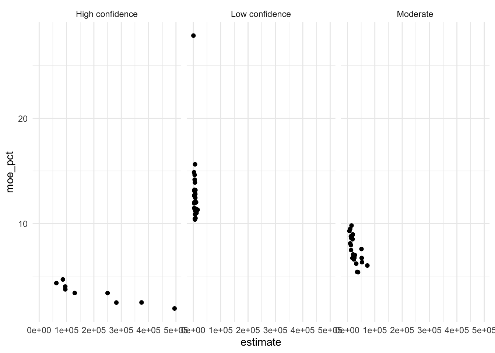
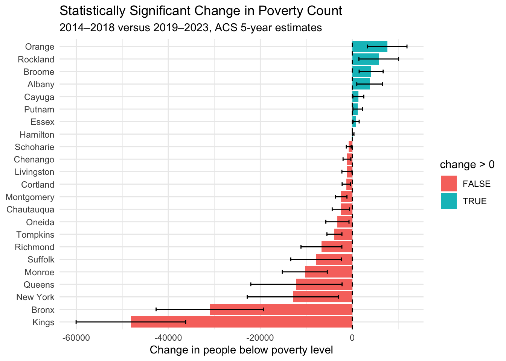

## This Week in One Picture

```text
Ask a question → choose a graph → show the data → show how wiggly the answer is
```

This week we learned how to make graphs with **ggplot2** and how to read estimates from the American Community Survey (ACS). A graph helps us see patterns. An uncertainty measure helps us remember that a survey estimate is not a perfect count.

## Why Pictures Help

### Anscombe’s Quartet

Anscombe’s Quartet is four small sets of numbers. The sets have almost the same averages, correlations, and fitted lines. But when we draw them, they look very different.

```text
Same-looking summary numbers ≠ same-looking data
```

One set might make a curve, another might have a far-away point, and another might make a neat line. A few summary numbers can hide these surprises. **Draw the data before deciding what it means.**

## Build a Graph with ggplot2

Think of a graph as a picture made from a few parts:

- **Data** → the table you want to draw.
- **Aesthetics** → which columns control position, color, or size.
- **Geometry** → the kind of marks to draw, such as dots or bars.

Download library first 
```r
install.packages(c("tidyverse", "tidycensus", "gt"))

library(tidyverse)
library(tidycensus)
library(gt)

```

```r

ggplot(my_data) +
  aes(x = population, y = estimate) +
  geom_point()
```

Read it like a recipe:

1. `ggplot(my_data)` picks the table and opens a blank canvas.
2. `aes(...)` maps columns to parts of the picture.
3. `geom_point()` draws dots.

Use the real name of your table in place of `my_data`.

### Map columns to the picture

For example, we could show:

| Column in the data | Part of the picture |
|:--|:--|
| `population` | Left-to-right position (x-axis) |
| `estimate` | Up-and-down position (y-axis) |
| `reliability` | Color |
| `moe` | Size or an error bar |

A graph can show several facts at once. For example, each dot can show a place’s population, estimate, and reliability.

### Map a column or choose one color?

Put a column **inside** `aes()` when it should control a visual feature:

```r

ggplot(my_data) +
  aes(x = population, y = estimate, color = reliability) +
  geom_point()
```

Now the dots get different colors depending on their `reliability` value.

Put a fixed choice **outside** `aes()` when every mark should look the same:

```r
#| eval: false
ggplot(my_data) +
  aes(x = population, y = estimate) +
  geom_point(color = "blue")
```

Here every dot is blue. The word `"blue"` is not a column in the table; it is a style choice.

```text
Inside aes()  → a column from the data chooses the look
Outside aes() → you choose one look for every mark
```

## Pick a Graph That Answers Your Question

| What do I want to see? | Try this |
|:--|:--|
| How one number is spread out | `geom_histogram()` |
| How two numbers go together | `geom_point()` |
| How groups compare | `geom_boxplot()` or `geom_col()` |
| How something changes over time | `geom_line()` |
| How much wiggle room an estimate has | `geom_errorbar()` |

A **histogram** groups numbers into bins, like sorting blocks by height. A **scatterplot** uses dots to show two numbers together. A **boxplot** gives a quick picture of how values differ across groups. A **line graph** connects values in time order.

### Show groups in separate panels

A **facet** makes a small panel for each group. For example, this makes one panel for each reliability label:

```r
#| eval: false
ggplot(my_data) +
  aes(x = population, y = estimate) +
  geom_point() +
  facet_wrap(~reliability)
```

This can make groups easier to compare. Facets arrange the data; they do not change the data itself.

## ACS Estimates Have Wiggle Room

The ACS asks a sample of people questions and uses their answers to estimate things about a larger population. So an ACS number is an **estimate**, not an exact count of every person.

- **Estimate** → the survey’s best guess.
- **Margin of error (MOE)** → a range of wiggle room around that guess.
- **Standard error (SE)** → another way to measure how much the estimate might wobble.

A simple picture is:

```text
estimate − MOE  ← possible range →  estimate + MOE
```

ACS margins of error usually use a **90% confidence level**. For that level:

```text
MOE = 1.645 × SE
SE  = MOE ÷ 1.645
```

Example: If an estimate is `$45,000` and its MOE is `$8,000`, then its SE is about `$8,000 ÷ 1.645 = $4,863`.

### Draw the wiggle room

An error bar stretches from the estimate minus the MOE to the estimate plus the MOE:

```r
#| eval: false
ggplot(my_data) +
  aes(x = place, y = estimate) +
  geom_point() +
  geom_errorbar(aes(ymin = estimate - moe,
                    ymax = estimate + moe))
```

The dot is the estimate. The line is the wiggle room. Two dots can look different even when their long error bars overlap, so check the uncertainty too.

## How Reliable Is an Estimate?

The **coefficient of variation (CV)** compares the wiggle room to the size of the estimate. It is useful because an MOE of 100 may be small for an estimate of 10,000 but large for an estimate of 200.

```text
CV = (SE ÷ estimate) × 100
   = (MOE ÷ 1.645 ÷ estimate) × 100
```

- **Lower CV** → less uncertainty compared with the estimate.
- **Higher CV** → more uncertainty compared with the estimate.

Class notes use these rough guideposts: below 15% is low sampling error, 15–30% is medium, and above 30% is high. A class exercise or project may use different cutoffs, so follow the rule it gives you. These are helpful labels, not magic lines that make an estimate suddenly good or bad.

## New Calculations Need New Uncertainty

If we use survey estimates to calculate a new answer, that answer also has uncertainty. We need to carry the wiggle room along.

- `moe_sum()` → helps find the MOE when we add estimates.
- `moe_prop()` → helps find the MOE when one count is part of another, such as people in poverty out of all people.
- `moe_ratio()` → helps find the MOE for a ratio when the top count is **not** part of the bottom count.

A poverty rate is a **proportion** because the people in poverty are part of the total population:

```text
poverty rate = people in poverty ÷ total population
```

Do not just add MOEs together when adding estimates. Use the matching uncertainty function. If you turn a proportion into a percent by multiplying by 100, multiply its MOE by 100 too.

## Compare ACS Numbers Over Time

ACS 5-year estimates cover five years at once. That means nearby periods can overlap:

```text
2018–2022
   2019–2023  ← shares four years with the first period
```

A cleaner comparison uses periods that do not overlap, such as **2014–2018** and **2019–2023**. When comparing dollar amounts across years, remember that prices change; adjust income for inflation before explaining what the difference means.

### Example: Did income really go up?

Suppose the estimates are:

| Period | Estimate | MOE |
|:--|--:|--:|
| 2014–2018 | $45,000 | $8,000 |
| 2019–2023 | $62,000 | $11,000 |

The difference is `$62,000 − $45,000 = $17,000`. But both estimates have wiggle room. We need to check the wiggle room around the **difference** too.

First find each standard error, then combine them:

```text
SE₁ = 8,000 ÷ 1.645  ≈ 4,863
SE₂ = 11,000 ÷ 1.645 ≈ 6,687

SE of the difference = √(SE₁² + SE₂²) ≈ 8,268
```

For a 90% confidence interval around the change, multiply by 1.645:

```text
change ± (1.645 × SE of the difference)
$17,000 ± $13,601
about $3,399 to $30,601
```

This range stays above zero, so these estimates give evidence of an increase at the 90% level, using this method. If a change’s range crosses zero, the data do not clearly tell us whether it went up, went down, or stayed about the same. A difference between two estimates by itself does not prove a clear change.

## R Practice: New York County Data

The pages use New York county data about people living below the poverty level. `get_acs()` downloads estimates and MOEs. Here are small, non-running examples to show the pattern; the real pages include longer code and charts.

```r
#| eval: false
library(tidycensus)

county_data <- get_acs(
  geography = "county",
  variables = "B17001_002", # people below the poverty level
  state = "NY",
  year = 2023,
  survey = "acs5"
)
```

The result has columns such as `GEOID` (place ID), `NAME` (place name), `estimate`, and `moe`. We can add a relative MOE column and a simple label:

```r
#| eval: false
county_data <- county_data |>
  mutate(
    moe_pct = moe / estimate * 100,
    reliability = case_when(
      moe_pct < 5  ~ "High confidence",
      moe_pct < 10 ~ "Moderate",
      TRUE         ~ "Low confidence"
    )
  )
```

This example uses **MOE as a percent of the estimate**, which is not the same as CV. For CV, first change MOE to SE by dividing by 1.645. Reliability labels and cutoffs depend on the rule chosen for a particular exercise.

We can then color the dots by reliability or show one panel per reliability group:

```r
#| eval: false
ggplot(county_data) +
  aes(x = estimate, y = moe_pct, color = reliability) +
  geom_point() +
  facet_wrap(~reliability)
```

For a long list of counties, a chart can get crowded. One helpful step is to sort places by MOE and show a smaller group. Another is to use `coord_flip()` so long place names are easier to read.

### The Week 3 plots, step by step

The next pictures use New York county data from the example above. The code is shown so you can see how each picture was made. These pictures are the saved results from the linked Week 3 example page.

For the colored-dot plots, the example page labels counties using `moe_pct`: under 5% is high confidence, 5–10% is moderate, and 10% or more is low confidence. That is a different rule from the CV guideposts above, so always check which measure and cutoffs a graph uses.

#### 1. Put two numbers on a scatterplot

Each dot is one county. The bottom axis shows the poverty estimate; the side axis shows its margin of error as a percent of the estimate.

```r
#| eval: false
ggplot(county_data, aes(x = estimate, y = moe_pct)) +
  geom_point()
```



#### 2. Let a data column choose the color

Here, each county’s reliability label chooses the dot’s color. The legend explains what the colors mean.

```r
#| eval: false
ggplot(county_data, aes(
  x = estimate,
  y = moe_pct,
  color = reliability
)) +
  geom_point()
```



#### 3. Choose one color for every dot

This time, `"blue"` is a style choice, so it goes outside `aes()`. It does not come from a data column.

```r
#| eval: false
ggplot(county_data, aes(x = estimate, y = moe_pct)) +
  geom_point(color = "blue")
```



#### 4. Add an error bar to show wiggle room

The bar stretches from the estimate minus its MOE to the estimate plus its MOE. One bar is drawn for each county.

```r
#| eval: false
ggplot(county_data, aes(x = NAME, y = estimate)) +
  geom_col() +
  geom_errorbar(
    aes(ymin = estimate - moe, ymax = estimate + moe)
  )
```



#### 5. Make a long chart easier to read

Showing every county at once can be crowded. This code keeps the 15 counties with the largest relative MOEs and turns the chart sideways so the names fit.

```r
#| eval: false
top_15 <- county_data |>
  arrange(desc(moe_pct)) |>
  slice_head(n = 15) |>
  mutate(NAME = stringr::str_remove(NAME, " County, New York"))

ggplot(top_15, aes(x = reorder(NAME, estimate), y = estimate)) +
  geom_col(fill = "steelblue") +
  geom_errorbar(
    aes(ymin = estimate - moe, ymax = estimate + moe),
    width = 0.3
  ) +
  coord_flip()
```



#### 6. Put each reliability group in its own panel

`facet_wrap()` makes one small graph for each reliability label. This can make the groups easier to compare.

```r
#| eval: false
ggplot(county_data, aes(x = estimate, y = moe_pct)) +
  geom_point() +
  facet_wrap(~reliability) +
  theme_minimal()
```



#### 7. Show which county estimates changed clearly

These bars compare poverty counts in two five-year periods that do not overlap. Each error bar shows uncertainty around the change. A bar that stays on one side of zero gives evidence of a change; one that crosses zero is less clear.

First, put both periods side by side and calculate the difference and its MOE:

```r
#| eval: false
poverty_wide <- poverty_change |>
  select(GEOID, NAME, period, estimate, moe) |>
  tidyr::pivot_wider(
    names_from = period,
    values_from = c(estimate, moe)
  )

poverty_tested <- poverty_wide |>
  mutate(
    change = `estimate_2019-2023` - `estimate_2014-2018`,
    se_1 = `moe_2014-2018` / 1.645,
    se_2 = `moe_2019-2023` / 1.645,
    se_diff = sqrt(se_1^2 + se_2^2),
    moe_diff = 1.645 * se_diff,
    z = change / se_diff,
    significant = abs(z) > 1.645
  )
```

Then draw the counties whose changes are large compared with their wiggle room:

```r
#| eval: false
poverty_tested |>
  filter(significant) |>
  mutate(NAME = stringr::str_remove(NAME, " County, New York")) |>
  ggplot(aes(x = reorder(NAME, change), y = change)) +
  geom_col(aes(fill = change > 0)) +
  geom_errorbar(
    aes(ymin = change - moe_diff, ymax = change + moe_diff),
    width = 0.3
  ) +
  geom_hline(yintercept = 0, linetype = "dashed") +
  coord_flip() +
  theme_minimal()
```



The plot code uses a data table named `poverty_change` with one row per county and period. It can be made by running the `get_poverty()` recipe for 2018 and 2023, then stacking the two results with `dplyr::bind_rows()`.


### Save a little recipe as a function

An R **function** is a recipe we can use again. This example asks for the same kind of poverty estimate for whichever year we give it, then labels the five-year period:

```r
#| eval: false
get_poverty <- function(year_end) {
  get_acs(
    geography = "county",
    variables = "B17001_002",
    state = "NY",
    year = year_end,
    survey = "acs5"
  ) |>
    mutate(period = paste0(year_end - 4, "–", year_end))
}

# Ask the recipe for two different periods:
poverty_2018 <- get_poverty(2018) # 2014–2018
poverty_2023 <- get_poverty(2023) # 2019–2023
poverty_change <- dplyr::bind_rows(poverty_2018, poverty_2023)
```

Writing the function makes the recipe; it does not download anything yet. Calling it with `2018` or `2023` runs the recipe for that period.

## Tiny Glossary

| Word | Kid-friendly meaning |
|:--|:--|
| Data | The facts in your table |
| Estimate | The survey’s best guess |
| MOE | How far the guess might wiggle |
| SE | A measure of how much the guess might wobble |
| CV | Wiggle room compared with the size of the guess |
| `aes()` | The instructions that connect data columns to the picture |
| `geom_*()` | The kind of marks the graph draws |
| Facet | A little graph panel for each group |

## Remember These

- Draw the data: matching averages do not guarantee matching patterns.
- A ggplot is built from data, mappings, and a geometry.
- Inside `aes()` means a data column controls a visual feature; outside means one fixed style.
- Choose a graph that fits your question.
- ACS numbers are estimates. Read the MOE too.
- CV compares uncertainty with the size of the estimate.
- Use the right `moe_*()` helper when calculating a new number.
- Avoid overlapping ACS 5-year periods when comparing change.
- Check the uncertainty around a difference; see whether its range includes zero.

## Reflection

- A picture can show patterns that averages hide.
- Survey estimates have wiggle room, and we can show that wiggle room with numbers and graphs.
- Before saying something changed, I should check whether the change is bigger than its uncertainty.


