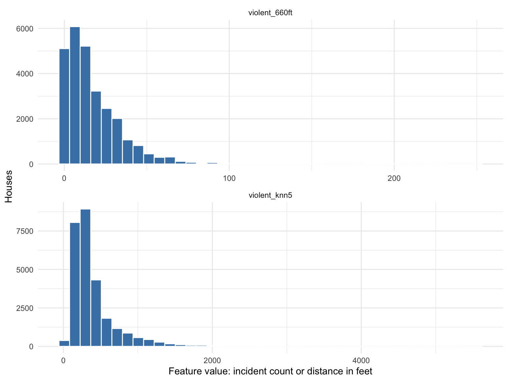
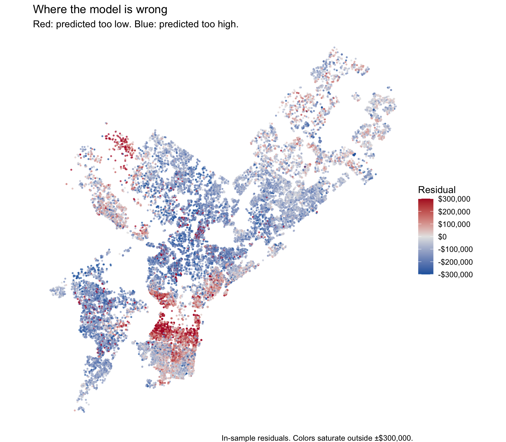
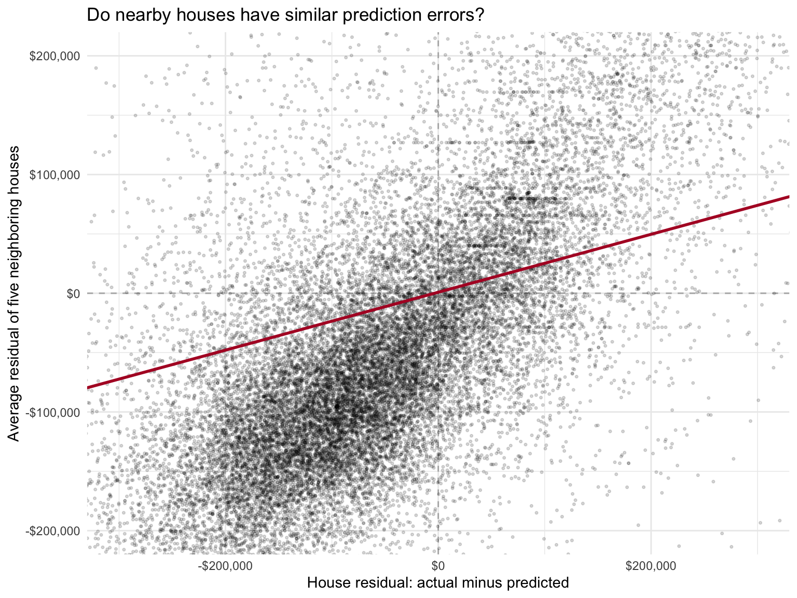
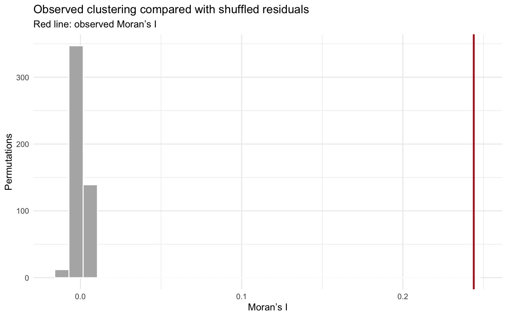
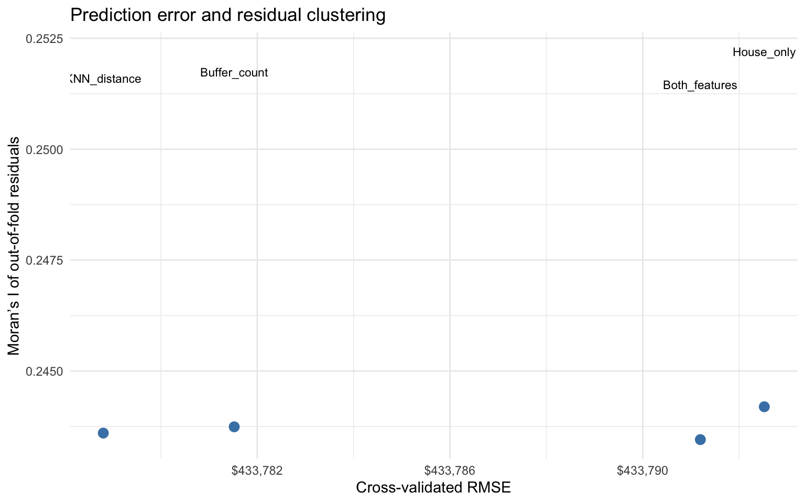

## What we covered

These notes follow the Philadelphia house-price example and its spatial diagnostics. The R chunks are study examples and are not executed when this page renders. The figures retain the example outputs; lecture-reported values are identified separately in the text.

This week moves from predicting median rent for census tracts to predicting prices for individual houses. The main question is whether the model makes similar mistakes in nearby places.

A model can have a reasonable overall error and still consistently undervalue houses in one area and overvalue houses in another. Residual maps show where those mistakes occur. Moran’s I measures whether nearby errors tend to resemble one another.

We also build two kinds of spatial features: counts within a buffer and distances to nearby events. The Philadelphia example leads into the Chicago house-price prediction assignment.

## Review: interpreting a logged predictor

Suppose the fitted relationship is:

$$
\widehat{rent} = \hat\beta_0 + 210\log(income).
$$

Rent remains in dollars, but income is logged. A **1% increase in income** corresponds to approximately:

$$
210 / 100 = \$2.10
$$

more predicted monthly rent, holding any other predictors fixed. The exact change is `210 * log(1.01)`, about $2.09. A 10% increase corresponds to `210 * log(1.10)`, about $20.02, rather than exactly ten times the 1% approximation.

The log allows a curved relationship with income in its original dollar units. An additional $10,000 represents a much larger percentage increase from $20,000 than from $200,000. Whether this improves predictions is a question for cross-validation, not something the transformation guarantees.

## Review: the factor level that broke a fold

```text
Error: factor district has new levels Upper Far Northeast
```

This means the validation data contain a category that the fitted model did not see in training. If all observations from a small district are held out together, the model has no estimated coefficient for that district.

Possible responses include a defensible merge of small groups, a coarser geography, or a model that can handle new groups. Simply listing a category as a factor level does not create information to estimate its coefficient.

There are many more neighborhoods than planning districts, so sparse categories become a bigger issue in house-level analysis. Count group sizes and check training coverage in every fold. If grouping rules are chosen using outcomes, they must be learned within training folds; preset geographic groupings should also make sense for the intended prediction task.

## From census tracts to individual houses

| Question | Tract analysis | House analysis |
|---|---|---|
| What is one observation? | A tract | A property record with a sale price |
| What geometry represents it? | Polygon | Point |
| How might we count nearby incidents? | Within the tract boundary | Within a buffer around the house |
| How might we measure accessibility? | Distance to a station | Distance to the nearest station or average distance to several stations |
| What is the outcome? | Median rent | Sale price |

A **buffer** is a polygon constructed around a feature at a specified distance. Around a point, a planar buffer approximates a circle. A 660-foot buffer has a radius of 660 feet, or one eighth of a mile. Its diameter is 1,320 feet.

A buffer is based on straight-line distance. It does not represent a walking route or account for barriers such as rivers and highways.

## Packages and the data-query helper

```{r}
#| label: spatial-errors-setup

library(tidyverse)
library(sf)
library(spdep)
library(nngeo)

options(scipen = 999)
theme_set(theme_minimal())

carto_get <- function(sql) {
  url <- paste0(
    "https://phl.carto.com/api/v2/sql?format=GeoJSON&q=",
    URLencode(sql, reserved = TRUE)
  )
  st_read(url, quiet = TRUE)
}
```

| Package | Role |
|---|---|
| `tidyverse` | Clean tables, create features, and draw charts |
| `sf` | Read spatial data, transform coordinates, make buffers, and map geometry |
| `nngeo` | Find nearest features and their distances |
| `spdep` | Build spatial weights, calculate spatial lags, and assess spatial autocorrelation |

`options(scipen = 999)` discourages scientific notation in printed numbers; it does not change their values.

`carto_get()` is a custom function. Its input is a SQL query stored as text. `paste0()` constructs the request URL, `URLencode()` makes the query suitable for a URL, and `st_read()` reads the returned GeoJSON into an `sf` object.

The function definition stores the instructions. The data request happens when we call `carto_get(...)`.

## Download Philadelphia property records

```{r}
#| label: spatial-errors-download-sales
#| results: hide

sales_raw <- carto_get(
  "SELECT the_geom, parcel_number, sale_price, sale_date,
          total_livable_area, number_of_bedrooms,
          number_of_bathrooms, year_built, interior_condition
   FROM opa_properties_public
   WHERE category_code = '1'
     AND sale_date >= '2023-01-01'
     AND sale_date < '2025-01-01'"
) %>%
  st_transform(2272)
```

The SQL has three main parts:

- `SELECT` names the columns to return. `the_geom` contains geometry.
- `FROM` identifies the source table.
- `WHERE` limits the records to the chosen property category and sale-date range.

The start date is included and the end date is excluded. This covers 2023 and 2024, not 2025.

This query uses the sale fields in the OPA property table. We should not assume it is a complete transaction history of every sale a parcel has ever had. It is also a live source, so later updates can change the returned records.

```{r}
#| label: spatial-errors-inspect-sales

nrow(sales_raw)
summary(sales_raw$sale_price)
st_crs(sales_raw)$units_gdal

sales_raw %>%
  st_drop_geometry() %>%
  select(parcel_number, sale_price, sale_date, total_livable_area) %>%
  head()
```

The lecture output contained **37,866 records**, with a minimum price of $0, median of $190,000, and maximum of $15,428,633. These describe the lecture's downloaded data before cleaning; they are not model performance statistics.

`st_transform(2272)` puts the Philadelphia data in Pennsylvania South State Plane coordinates, measured in **US survey feet**. This matters because the buffer radius of 660 is interpreted in the projected coordinate units.

## Not every recorded transfer is a market sale

Very low prices can reflect family transfers or other transactions that do not represent an ordinary market purchase. Other unusual sales may also require attention. A price cutoff is a practical screening rule, not proof that every retained record is an arm's-length sale.

```{r}
#| label: spatial-errors-price-bands

sales_raw %>%
  st_drop_geometry() %>%
  count(
    price_band = cut(
      sale_price,
      breaks = c(-Inf, 1000, 10000, 50000, Inf),
      labels = c("Up to $1,000", "Over $1,000–$10,000",
                 "Over $10,000–$50,000", "Over $50,000")
    )
  )
```

With the default `cut()` settings, an interval includes its upper boundary. A sale at exactly $1,000 belongs to the first band. This exploratory grouping is separate from the cleaning cutoff below, which retains prices at exactly $10,000.

### Apply cleaning rules and show their effect

```{r}
#| label: spatial-errors-clean-sales

sales_market <- sales_raw %>%
  filter(is.finite(sale_price), sale_price >= 10000)

sales_space <- sales_market %>%
  filter(
    is.finite(total_livable_area),
    total_livable_area > 0,
    !st_is_empty(geometry),
    st_geometry_type(geometry) == "POINT"
  )

sales <- sales_space %>%
  mutate(
    year_built = na_if(as.numeric(year_built), 0),
    age = 2024 - year_built
  ) %>%
  filter(
    is.finite(age), age >= 0,
    is.finite(number_of_bathrooms), number_of_bathrooms >= 0
  ) %>%
  arrange(parcel_number, sale_date, sale_price) %>%
  mutate(record_id = row_number())

cleaning_log <- tibble(
  stage = c("Downloaded", "Price at least $10,000",
            "Positive area and point geometry", "Usable age and bathrooms"),
  remaining = c(nrow(sales_raw), nrow(sales_market),
                nrow(sales_space), nrow(sales))
) %>%
  mutate(removed_at_step = lag(remaining, default = first(remaining)) - remaining)

cleaning_log
```

`na_if(year_built, 0)` treats a recorded construction year of zero as unknown. `age = 2024 - year_built` is a common reference-year age, following the class example. It is not exactly age at sale for every observation.

The lecture retained **27,551 records**. The checks here also require finite values, nonnegative ages and bathroom counts, and point geometry. The cleaning log reports the actual retained sample.

We do not remove every expensive house simply because it is hard to predict. Any upper-price cutoff needs a reason tied to the population we intend to model. Record the number of rows removed and consider whose homes are being excluded.

### Check repeated properties and locations

```{r}
#| label: spatial-errors-duplicate-checks

sales %>%
  st_drop_geometry() %>%
  count(parcel_number) %>%
  filter(n > 1) %>%
  head(10)

coords <- st_coordinates(sales)

tibble(
  records = nrow(sales),
  repeated_coordinate_rows = sum(duplicated(coords))
)
```

Multiple rows at the same point might represent repeated property records, shared geocoding, or distinct units. They need inspection, not automatic deletion. Repeated records from the same property should not be split between training and validation if that would let the model recognize the same property on both sides.

## Create spatial predictors from incident locations

```{r}
#| label: spatial-errors-download-incidents
#| results: hide

violent <- carto_get(
  "SELECT the_geom FROM incidents_part1_part2
   WHERE dispatch_date >= '2023-01-01'
     AND dispatch_date < '2025-01-01'
     AND text_general_code IN (
       'Aggravated Assault Firearm',
       'Aggravated Assault No Firearm',
       'Robbery Firearm',
       'Robbery No Firearm'
     )"
) %>%
  filter(!st_is_empty(geometry), st_geometry_type(geometry) == "POINT") %>%
  st_transform(2272)

stopifnot(nrow(violent) >= 5)
```

`IN (...)` selects records whose category matches one of the listed values. The object name `violent` is shorthand for these **selected assault and robbery categories**, not a count of every possible violent offense.

Both layers must use the same CRS. We are relating house points to incident points using distance, not joining them by a shared ID.

### Feature A: incidents inside a fixed buffer

```{r}
#| label: spatial-errors-buffer-count

sales <- sales %>%
  mutate(
    violent_660ft = lengths(
      st_intersects(st_buffer(geometry, dist = 660), violent)
    )
  )

summary(sales$violent_660ft)
```

There are three nested operations:

1. `st_buffer()` draws a 660-foot buffer around each house.
2. `st_intersects()` returns a list of incident-row indices that intersect each buffer.
3. `lengths()` counts the matches in each list element.

`lengths()` is plural because it measures each element of the list. `length()` would give one number: the length of the list itself.

If a house has no selected incidents within its buffer, its count is zero. An incident can be counted for several nearby houses because their buffers overlap. That is expected for a proximity feature; summing the house counts would not give a citywide count of unique incidents.

### Feature B: average distance to the five nearest incidents

```{r}
#| label: spatial-errors-knn-distance

incident_neighbors <- st_nn(
  sales,
  violent,
  k = 5,
  returnDist = TRUE,
  progress = FALSE
)

stopifnot(all(lengths(incident_neighbors$dist) == 5))

sales$violent_knn5 <- vapply(incident_neighbors$dist, mean, numeric(1))

sales %>%
  st_drop_geometry() %>%
  select(record_id, violent_660ft, violent_knn5) %>%
  head()
```

`k = 5` requests five neighbors per house. `$dist` selects the returned distance lists. `vapply(..., mean, numeric(1))` calculates one numeric mean per house; it serves the same purpose as the lecture's `sapply(..., mean)` with an explicit expected output type.

For projected point inputs, this nearest-neighbor calculation uses the coordinate scale. Here the distances are in US survey feet. Always check the CRS rather than assuming all spatial distances are meters.

| Feature | What is fixed? | What varies? | Interpretation |
|---|---|---|---|
| `violent_660ft` | Radius: 660 feet | Number of incidents | More means more selected incidents nearby |
| `violent_knn5` | Number of incidents: five | Average distance | Smaller means selected incidents are closer |

The kNN feature can distinguish houses whose buffer counts are both zero. It still finds the nearest incidents even if they are far away. Unlike a fixed buffer, its geographic reach expands in sparse areas.

A nearest-neighbor distance can be zero when features share coordinates; the average of five distances can also be zero if all five coincide with the house. “kNN is never zero” is a useful classroom contrast with zero counts, but not a mathematical guarantee.

```{r}
#| label: spatial-errors-feature-distributions
#| fig-alt: "Distributions of selected incident counts within 660 feet of each house and mean distance to the five nearest selected incidents, in feet."
#| fig-width: 8
#| fig-height: 6

sales %>%
  st_drop_geometry() %>%
  select(violent_660ft, violent_knn5) %>%
  pivot_longer(everything(), names_to = "feature", values_to = "value") %>%
  ggplot(aes(x = value)) +
  geom_histogram(bins = 40, fill = "steelblue", color = "white") +
  facet_wrap(~ feature, scales = "free", ncol = 1) +
  labs(x = "Feature value: incident count or distance in feet", y = "Houses")
```

{fig-alt="Distributions of selected incident counts within 660 feet of each house and mean distance to the five nearest selected incidents, in feet."}

These are contextual predictors, not proof that crime causes the observed price differences. Reporting patterns, geocoding quality, omitted neighborhood characteristics, and the selected crime categories all affect their meaning.

**Timing matters:** the class example uses 2023–2024 incidents for 2023–2024 sales. For a genuinely forward-looking prediction at a sale date, some of those incidents would not yet be known. Historical predictors should use information available before the prediction date. A feature can leak future information even when it is not a price variable.

## Fit the house-price model

```{r}
#| label: spatial-errors-fit-model

model_data <- sales %>% st_drop_geometry()

f_knn <- sale_price ~ total_livable_area + number_of_bathrooms + age + violent_knn5

m1 <- lm(f_knn, data = model_data, na.action = na.fail)

sales$pred <- as.numeric(predict(m1, newdata = model_data))
sales$resid <- sales$sale_price - sales$pred

summary(m1)
```

The formula models sale price using floor area, bathrooms, age, and mean distance to nearby incidents. The outcome remains in dollars. An intercept is included by default.

`na.action = na.fail` stops if a required value is missing. This prevents the fitted model from silently using a different row set from the spatial weights or residual map.

These predictions come from a model fitted to the same observations. They are **in-sample fitted values**. They help diagnose the model, but do not replace held-out evaluation.

## Understand the sign of a residual

$$
residual = actual - predicted.
$$

| Actual price | Predicted price | Residual | Meaning |
|---:|---:|---:|---|
| $300,000 | $250,000 | +$50,000 | Model predicted too low |
| $300,000 | $350,000 | −$50,000 | Model predicted too high |
| $300,000 | $300,000 | $0 | Exact fitted value |

**Positive residual = underprediction. Negative residual = overprediction.**

This sign convention matters for assessment fairness. A home the model overvalues has a negative actual-minus-predicted residual. Whether that translates into a higher tax bill depends on how the assessment and tax system uses the valuation.

## Map where the model is wrong

```{r}
#| label: spatial-errors-residual-map
#| fig-alt: "Philadelphia houses colored by in-sample sale-price residuals: red indicates underprediction and blue indicates overprediction, with colors saturated beyond plus or minus 300,000 dollars."
#| fig-width: 8
#| fig-height: 7

ggplot(sales) +
  geom_sf(aes(color = resid), size = 0.4, alpha = 0.6) +
  scale_color_gradient2(
    low = "#2166ac",
    mid = "grey90",
    high = "#b2182b",
    midpoint = 0,
    limits = c(-300000, 300000),
    oob = scales::squish,
    labels = scales::label_dollar()
  ) +
  theme_void() +
  labs(
    color = "Residual",
    title = "Where the model is wrong",
    subtitle = "Red: predicted too low. Blue: predicted too high.",
    caption = "In-sample residuals. Colors saturate outside ±$300,000."
  )
```

{fig-alt="Philadelphia houses colored by in-sample sale-price residuals: red indicates underprediction and blue indicates overprediction, with colors saturated beyond plus or minus 300,000 dollars."}

`alpha` controls transparency so overlapping points are easier to see. `midpoint = 0` centers the diverging palette on a correct prediction.

`scales::squish` assigns values outside the color limits to the end colors. It **does not** change the residuals, remove expensive houses, or cap errors in RMSE. A −$900,000 residual and a −$300,000 residual receive the same end color, so inspect the numeric extremes too.

```{r}
#| label: spatial-errors-largest-errors

sales %>%
  st_drop_geometry() %>%
  arrange(desc(abs(resid))) %>%
  select(parcel_number, sale_price, pred, resid) %>%
  slice_head(n = 10)
```

Clusters of red suggest places the model tends to underpredict; clusters of blue suggest places it tends to overpredict. They may point to missing features or an unsuitable model form, but a map alone does not identify the cause.

## Spatial autocorrelation

Spatial autocorrelation describes how a variable relates to itself across locations. Here the variable is the **model residual**.

- Positive spatial autocorrelation: nearby errors tend to have similar values.
- Negative spatial autocorrelation: nearby errors tend to differ.
- Little global spatial autocorrelation: no strong overall association under the chosen neighborhood definition.

For example, if five nearby houses are all underpredicted by roughly $80,000, the model may be missing a local amenity, property characteristic, or relationship that differs in that area.

Global absence of a pattern is not proof that all errors are independent. Local clusters can cancel one another in an overall statistic, and patterns depend on the scale at which neighbors are defined.

## Two different uses of kNN

**kNN** means *k nearest neighbors*. It is a way of selecting nearby observations, not automatically a particular prediction model.

| Use | Starting point | Neighbors | Purpose |
|---|---|---|---|
| Spatial predictor | House | Five incident locations | Measure proximity to selected incidents |
| Residual diagnostic | House | Five other houses | Compare the house's error with nearby errors |

The first becomes a model input. The second helps evaluate model errors. Neighboring residuals require observed outcomes, so they are not an available predictor for a new house whose price is unknown.

## Build a spatial weights object

```{r}
#| label: spatial-errors-weights

coords <- st_coordinates(sales)
stopifnot(nrow(coords) == nrow(sales), nrow(coords) > 5, all(is.finite(coords)))

has_duplicate_locations <- anyDuplicated(coords) > 0

house_knn <- knearneigh(
  coords,
  k = 5,
  longlat = FALSE,
  use_kd_tree = !has_duplicate_locations
)

house_nb <- knn2nb(house_knn)
w_knn <- nb2listw(house_nb, style = "W")

table(card(house_nb))
head(vapply(w_knn$weights, sum, numeric(1)))
```

The steps are:

1. `st_coordinates()` extracts each house's projected X and Y coordinates.
2. `knearneigh(..., k = 5)` identifies five other nearby houses, excluding the observation itself.
3. `knn2nb()` converts those indices to a neighbor-list object.
4. `nb2listw(..., style = "W")` assigns row-standardized weights.

With five equally weighted neighbors, each receives weight **1/5 = 0.2**, and each row's weights sum to one. `card()` reports each observation's number of neighbors.

Duplicate coordinates can produce warnings and distance ties. The code turns off the kd-tree path when duplicates are present, but this does not resolve the substantive question of why multiple records share a location. Ties can make neighbor selection sensitive to record order.

A kNN relation is not necessarily mutual: B can be among A's five closest houses without A being among B's five closest. Symmetrizing the graph changes the neighbor definition and may give some houses more than five neighbors.

Do not sort or remove rows after building `w_knn` and then apply it to a differently ordered residual vector. The neighbor indices refer to the existing row positions. Rebuild weights if the analysis sample changes.

## The spatial lag: a weighted average of nearby values

```{r}
#| label: spatial-errors-lag

sales$resid_lag <- lag.listw(w_knn, sales$resid)

sales %>%
  st_drop_geometry() %>%
  select(record_id, resid, resid_lag) %>%
  head()
```

Here `resid_lag` is the average residual of each house's five neighbors. “Lag” means a value calculated using spatial neighbors; it does not mean the previous row or the previous year.

If a house's five neighbors have residuals of $10,000, $20,000, $30,000, $40,000, and $50,000, its spatial lag is $30,000. Its own residual is not included.

## Compare my error with my neighbors' errors

```{r}
#| label: spatial-errors-moran-scatter
#| fig-alt: "Each house's sale-price residual plotted against the average residual of its five nearest neighboring houses, with zero reference lines and a fitted trend."
#| fig-width: 8
#| fig-height: 6

ggplot(sales, aes(x = resid, y = resid_lag)) +
  geom_hline(yintercept = 0, color = "grey70", linetype = "dashed") +
  geom_vline(xintercept = 0, color = "grey70", linetype = "dashed") +
  geom_point(alpha = 0.15, size = 0.6) +
  geom_smooth(method = "lm", formula = y ~ x, se = FALSE, color = "#b2182b") +
  coord_cartesian(xlim = c(-300000, 300000), ylim = c(-200000, 200000)) +
  scale_x_continuous(labels = scales::label_dollar()) +
  scale_y_continuous(labels = scales::label_dollar()) +
  labs(
    title = "Do nearby houses have similar prediction errors?",
    x = "House residual: actual minus predicted",
    y = "Average residual of five neighboring houses"
  )
```

{fig-alt="Each house's sale-price residual plotted against the average residual of its five nearest neighboring houses, with zero reference lines and a fitted trend."}

| Part of the plot | Interpretation |
|---|---|
| Upper right | House and neighbors are underpredicted |
| Lower left | House and neighbors are overpredicted |
| Upper left | House is overpredicted while neighbors are underpredicted |
| Lower right | House is underpredicted while neighbors are overpredicted |

The reference lines are at zero. For general variables, Moran scatterplots use deviations from the overall mean. An ordinary least-squares model with an intercept has in-sample residuals whose mean is approximately zero.

`coord_cartesian()` zooms the visible region while retaining the full dataset for the fitted line. It does not restrict the observations used for Moran’s I.

With row-standardized weights and a neighbor for every observation, the slope of the spatial-lag-versus-value regression corresponds to Moran’s I. The weighting convention matters.

## Moran’s I, one part at a time

$$
I = \frac{n}{S_0}
\frac{\sum_i\sum_j w_{ij}(x_i-\bar{x})(x_j-\bar{x})}
{\sum_i(x_i-\bar{x})^2},
\qquad S_0 = \sum_i\sum_j w_{ij}.
$$

| Symbol | Meaning in this analysis |
|---|---|
| `n` | Number of houses |
| `x_i` | Residual for house i |
| `x̄` | Mean residual |
| `w_ij` | Weight connecting house i to house j |
| `S₀` | Sum of all weights |

The numerator multiplies deviations at neighboring locations. Two positive deviations make a positive product; two negative deviations also make a positive product. Opposite signs make a negative product. The denominator scales by the overall variation in the values.

The question is: **when a house's error is above average, are its neighbors' errors also above average?**

For row-standardized weights with no isolated observations, every row sums to one, so `S₀ = n` and the leading fraction equals one.

### Five houses on a block

Use the lecture's residuals, expressed in thousands of dollars:

```{r}
#| label: spatial-errors-five-houses

block_example <- tibble(
  house = LETTERS[1:5],
  residual_thousands = c(100, 80, 20, -50, -70)
) %>%
  mutate(deviation = residual_thousands - mean(residual_thousands))

block_example
```

The mean is +16, so the deviations are +84, +64, +4, −66, and −86. Define neighbors as the houses immediately next door: A–B, B–C, C–D, and D–E.

| Pair | Product of deviations |
|---|---:|
| A–B | 84 × 64 = 5,376 |
| B–C | 64 × 4 = 256 |
| C–D | 4 × −66 = −264 |
| D–E | −66 × −86 = 5,676 |

The products sum to 11,044. With a **binary, symmetric** neighbor matrix, each pair is counted in both directions. The numerator is therefore 22,088 and the sum of weights is eight.

The sum of squared deviations is 22,920:

$$
I = \frac{5}{8}\frac{22088}{22920} \approx 0.6023.
$$

```{r}
#| label: spatial-errors-manual-moran

z_block <- block_example$deviation
W_binary <- matrix(0, nrow = 5, ncol = 5)

for (i in 1:4) {
  W_binary[i, i + 1] <- 1
  W_binary[i + 1, i] <- 1
}

I_binary <- (length(z_block) / sum(W_binary)) *
  as.numeric(t(z_block) %*% W_binary %*% z_block) / sum(z_block^2)

W_row <- W_binary / rowSums(W_binary)
I_row <- (length(z_block) / sum(W_row)) *
  as.numeric(t(z_block) %*% W_row %*% z_block) / sum(z_block^2)

tibble(
  weights = c("Binary next-door weights", "Row-standardized next-door weights"),
  morans_I = c(I_binary, I_row)
)
```

The row-standardized version is about **0.7229**. The result differs because the end houses have one neighbor while interior houses have two. The hand calculation uses binary weights; the house-price analysis uses row-standardized kNN weights. We should not switch between these conventions without saying so.

### Interpreting the statistic

Positive I indicates similar neighboring deviations overall. Negative I indicates a tendency toward contrasting neighboring deviations. Near-zero I suggests little overall spatial association at the chosen scale.

Moran’s I is not a percentage of variance explained. It does not mean “26% of houses are clustered” when I is 0.26. Its attainable range depends on the weights; it is not universally bounded exactly by −1 and +1 like an ordinary correlation coefficient.

Under a random-permutation null, its expected value is `-1 / (n - 1)`, which is close to zero for a large dataset. A global value close to that expectation does not rule out local patterns.

## Shuffle the residuals to assess the observed pattern

```{r}
#| label: spatial-errors-moran-permutation

set.seed(5080)

mc <- moran.mc(
  sales$resid,
  w_knn,
  nsim = 499,
  alternative = "greater"
)

tibble(
  morans_I = unname(mc$statistic),
  permutation_p = mc$p.value,
  permutations = 499
)
```

The locations and neighbor connections stay fixed. The function shuffles the residual values among those locations 499 times and compares the observed I with the simulated values.

`alternative = "greater"` asks whether the observed association is unusually positive. It is not a two-sided test for every possible spatial pattern.

The lecture reported **I = 0.2605251** and **p = 0.002**. That is evidence of positive residual clustering relative to this permutation reference. With 499 permutations, 1/500 = 0.002 is the smallest attainable conventional permutation p-value. It is not the probability that the model is correct or that the pattern happened “by luck.”

```{r}
#| label: spatial-errors-permutation-plot
#| fig-alt: "Moran's I values from shuffled residuals compared with the observed Moran's I, shown by a red vertical line."
#| fig-width: 8
#| fig-height: 5

permutation_values <- tibble(I = head(mc$res, -1))

ggplot(permutation_values, aes(x = I)) +
  geom_histogram(bins = 30, fill = "grey70", color = "white") +
  geom_vline(xintercept = unname(mc$statistic), color = "firebrick", linewidth = 1) +
  labs(
    title = "Observed clustering compared with shuffled residuals",
    subtitle = "Red line: observed Moran’s I",
    x = "Moran’s I",
    y = "Permutations"
  )
```

{fig-alt="Moran's I values from shuffled residuals compared with the observed Moran's I, shown by a red vertical line."}

With many observations, even small patterns can produce small p-values. Track the magnitude of I alongside prediction error. Residual permutation is useful here as a diagnostic; formal regression inference also needs assumptions about residual exchangeability and the fitted model.

## Cross-validation and the model log

The lecture fits the example model to map its errors. For comparing predictive features, we also need out-of-fold predictions. This extension evaluates a house-only baseline, buffer count, kNN distance, and both spatial predictors using the same observations and folds.

Repeated records with a known parcel number are kept together in a fold. This avoids putting the same known property in training and validation. Spatially separated folds would answer a different question about transfer to new areas.

```{r}
#| label: spatial-errors-cv-folds

model_data <- sales %>% st_drop_geometry()

property_group <- if_else(
  is.na(model_data$parcel_number) | as.character(model_data$parcel_number) == "",
  paste0("unknown-record-", model_data$record_id),
  paste0("parcel-", as.character(model_data$parcel_number))
)

unique_properties <- unique(property_group)
stopifnot(length(unique_properties) >= 10)

set.seed(5080)
property_folds <- sample(rep(1:10, length.out = length(unique_properties)))
fold_id <- property_folds[match(property_group, unique_properties)]

table(fold_id)
```

```{r}
#| label: spatial-errors-cv-function

cv_predictions <- function(formula, data, fold_id) {
  stopifnot(nrow(data) == length(fold_id), !anyNA(fold_id))
  predictions <- rep(NA_real_, nrow(data))

  for (k in sort(unique(fold_id))) {
    validation <- fold_id == k
    fit <- lm(formula, data = data[!validation, ], na.action = na.fail)
    predictions[validation] <- predict(fit, newdata = data[validation, ])
  }

  stopifnot(all(is.finite(predictions)))
  predictions
}

morans_i <- function(values, weights) {
  moran(
    values,
    weights,
    n = length(values),
    S0 = Szero(weights)
  )$I
}
```

Each house is predicted by a model that did not train on its fold. The predictions are returned in the original row order. This order must also match the spatial weights.

```{r}
#| label: spatial-errors-model-log

formulas <- list(
  House_only = sale_price ~ total_livable_area + number_of_bathrooms + age,
  Buffer_count = sale_price ~ total_livable_area + number_of_bathrooms + age + violent_660ft,
  KNN_distance = f_knn,
  Both_features = sale_price ~ total_livable_area + number_of_bathrooms + age +
    violent_660ft + violent_knn5
)

evaluations <- lapply(formulas, function(f) {
  fit <- lm(f, data = model_data, na.action = na.fail)
  oof_pred <- cv_predictions(f, model_data, fold_id)
  oof_resid <- model_data$sale_price - oof_pred

  list(
    oof_pred = oof_pred,
    oof_resid = oof_resid,
    cv_rmse = sqrt(mean(oof_resid^2)),
    moran_in_sample = morans_i(residuals(fit), w_knn),
    moran_out_of_fold = morans_i(oof_resid, w_knn)
  )
})

model_log <- imap_dfr(evaluations, function(result, model_name) {
  tibble(
    model = model_name,
    cv_rmse = result$cv_rmse,
    moran_in_sample = result$moran_in_sample,
    moran_out_of_fold = result$moran_out_of_fold
  )
})

model_log %>%
  arrange(cv_rmse) %>%
  knitr::kable(digits = c(0, 2, 3, 3))
```

The log records which residuals were used for Moran’s I. In-sample and out-of-fold residual diagnostics are different quantities. Do not compare them as if they were interchangeable.

| Metric | Question |
|---|---|
| CV RMSE | How large are held-out prediction errors, in dollars? |
| In-sample Moran’s I | Do errors from the fitted model cluster? |
| Out-of-fold Moran’s I | Do held-out prediction errors cluster? |

Lower RMSE is better on that scoring rule. Moran’s I nearer its null expectation means less global residual association under the chosen weights, not necessarily better overall prediction. A model can improve one metric while worsening the other.

```{r}
#| label: spatial-errors-model-comparison-plot
#| fig-alt: "Four house-price models compared by cross-validated dollar RMSE and Moran's I of out-of-fold residuals."
#| fig-width: 8
#| fig-height: 5

ggplot(model_log, aes(x = cv_rmse, y = moran_out_of_fold, label = model)) +
  geom_point(size = 3, color = "steelblue") +
  geom_text(nudge_y = 0.008, size = 3, check_overlap = TRUE) +
  scale_x_continuous(labels = scales::label_dollar()) +
  labs(
    title = "Prediction error and residual clustering",
    x = "Cross-validated RMSE",
    y = "Moran’s I of out-of-fold residuals"
  )
```

{fig-alt="Four house-price models compared by cross-validated dollar RMSE and Moran's I of out-of-fold residuals."}

These comparisons hold the sample, fold assignment, and neighbor weights constant. They remain subject to the timing limitation of the incident features and do not establish performance on a future city's housing market.

## What to do when errors cluster

Use the map to form a specific hypothesis:

| Possible explanation | Feature to investigate |
|---|---|
| Access to transit differs | Distance to stations or nearby service availability |
| Parks or other amenities differ | Nearby park area or distance to amenities |
| Recorded incidents differ | Buffer counts or distances to incidents |
| Neighborhood-wide price levels differ | Carefully defined neighborhood fixed effects |
| A relationship changes by place | An interaction, such as floor area × neighborhood |
| Housing quality is missing | Building condition or other available property attributes |

Refit and record both CV RMSE and Moran’s I. The residual map suggests questions; it does not supply a causal explanation by itself. Do not repeatedly tune features against a final test set.

The choice of five neighbors is also a modeling choice. It captures one local scale. A larger k examines a broader area; a smaller k is more local and may be noisier. Compare I across candidate models using the same definition, and label any sensitivity analysis that changes k.

## Spatial lag diagnostics are not spatial lag predictors

The diagnostic `lag.listw(w_knn, residuals)` summarizes neighboring errors after outcomes are known. A spatial lag model of the outcome has a different form:

$$
y = \rho Wy + X\beta + \varepsilon.
$$

Here `Wy` contains neighboring outcome values. For this assignment, the rule is to build spatial predictors from **X**, not from neighboring sale prices **Y**.

The risk is leakage: computing a price-based neighborhood feature from the complete dataset can carry validation outcomes into training features. Test prices are also unavailable, so a feature requiring them cannot be constructed at prediction time.

Spatial lag models are not universally incapable of prediction. They require appropriate estimation, prediction procedures, and information assumptions. Likewise, genuinely prior sale prices can be useful in other applications when carefully restricted to information available at the time. Those are separate methods, not a reason to ignore the assignment's rule.

An allowed non-price feature can still leak future information if its date is after the prediction date. Always ask: **Would I know this value when making the prediction?**

## Where does the model fail worst?

Overall RMSE can hide uneven performance. Inspect errors by price range, location, property size, and other relevant groups. A model that is acceptable for expensive houses may be poor for cheaper homes, or the reverse.

The following uses out-of-fold predictions from the kNN-distance model so each prediction was made without training on that property's fold.

```{r}
#| label: spatial-errors-price-group-audit

error_audit <- model_data %>%
  mutate(
    prediction = evaluations$KNN_distance$oof_pred,
    residual = sale_price - prediction,
    overvaluation_pct = 100 * (prediction - sale_price) / sale_price,
    price_group = cut(
      sale_price,
      breaks = c(-Inf, 100000, 250000, 500000, Inf),
      labels = c("Up to $100k", "$100k–$250k", "$250k–$500k", "Over $500k")
    )
  ) %>%
  group_by(price_group) %>%
  summarize(
    n = n(),
    rmse = sqrt(mean(residual^2)),
    mean_residual = mean(residual),
    median_overvaluation_pct = median(overvaluation_pct),
    .groups = "drop"
  )

error_audit %>% knitr::kable(digits = 2)
```

Here positive `overvaluation_pct` means predicted price is above actual price. That uses the opposite subtraction from the residual definition, so the column name makes the direction explicit.

Grouping by actual price is a **post-prediction diagnostic**, not a predictor. Price is available for the labeled training observations but unavailable for the competition test houses.

Percentage errors provide context that dollar RMSE lacks. A $30,000 overprediction is 30% of a $100,000 house's price but 3% of a $1 million house's price. Inspect sample sizes, outliers, and geographic distributions before making claims about systematic harm. Group error patterns alone do not establish the cause of inequity.

## Assignment 5: house-price prediction in Chicago

The October 16 lecture introduces a team competition using approximately 23,000 single-family sales from 2023–2025. The assignment applies the same workflow in Chicago rather than Philadelphia.

| Item | Requirement described in the lecture |
|---|---|
| Team | Four members, one team submission |
| Due date | Friday, October 30, 2026 |
| Outcome | Sale price, kept in dollars |
| Training file | `chicago_train.csv`, with prices |
| Test file | `chicago_test.csv`, without prices |
| Spatial CRS | EPSG 3435, Illinois East State Plane in US survey feet |
| Prediction file | `team_XX_predictions.csv` |
| Report | Every teammate renders the analysis on their own portfolio and submits that link on Canvas, following the assignment template |
| Model log | Each model's CV RMSE and Moran’s I |
| Error analysis | Where predictions fail worst and whose homes are overvalued |

The lecture connects the task to concerns about regressive property assessments discussed in the Chicago Tribune's *The Tax Divide*. The policy question is not only whether average prediction error is small, but whether errors burden cheaper homes disproportionately.

### What CV and the test set tell us

CV estimates performance using repeated held-out parts of the labeled training data. The instructor's test score evaluates predictions on a separate set whose prices were withheld.

A large difference between CV and test RMSE is a reason to investigate leakage, overfitting, different data distributions, spatial dependence, preprocessing inconsistencies, and sampling variability. It is **not automatic proof of leakage**. The test RMSE is an observed score on that test sample, not a universal truth about every future prediction.

### Training rules and test predictions

Outcome-based cleaning can be applied to training sales when justified, but test prices are unknown. Do not drop test rows simply because a predictor is missing; use a documented strategy learned from the training data. The required prediction file should retain the expected test identifiers and one prediction per required row.

The Chicago files were not part of this lecture example, so the Philadelphia column names should not be assumed to match their schema. Inspect the actual assignment data and template before writing the Chicago data-processing code.

### Individual understanding

The lecture says Q7 on October 30 asks about the team's own model: which features were used and why, how CV and test RMSE differ, and where the model fails worst. Every member needs to understand the shared model rather than only their own code contribution.

## Terms and syntax to remember

| Term or code | Meaning |
|---|---|
| Feature | An input used to predict the outcome |
| Residual | Actual minus predicted |
| `st_buffer(x, 660)` | Create a buffer using 660 coordinate units |
| `st_intersects(x, y)` | Identify spatial intersections |
| `lengths(list)` | Count elements within each list entry |
| `st_nn(x, y, k = 5)` | Find up to five nearby Y features for each X feature |
| `knearneigh(coords, k = 5)` | Identify neighbors among the observations |
| `knn2nb()` | Convert kNN output into a spatial neighbor list |
| `nb2listw(..., style = "W")` | Create row-standardized spatial weights |
| `lag.listw()` | Calculate weighted neighboring values |
| Moran’s I | Measure global spatial association under specified weights |
| `moran.mc()` | Compare observed I with randomly permuted values |
| `nsim = 499` | Use 499 random permutations |
| `scales::squish` | Clamp plotted colors at scale limits without changing data |
| `coord_cartesian()` | Zoom a chart without dropping observations before statistical layers |
| CV RMSE | Root mean squared error from out-of-fold predictions |
| Leakage | Information enters training or features that would be unavailable for a valid held-out prediction |

## Questions to check my understanding

1. How is a point buffer different from a census tract boundary?
2. What is fixed in a buffer count, and what is fixed in a kNN distance feature?
3. Why can two houses with zero buffer counts still have different kNN distances?
4. Why do we project Philadelphia data to EPSG 2272 before buffering?
5. What does a +$40,000 residual mean? What does −$40,000 mean?
6. Does `scales::squish` change the errors used in RMSE?
7. Which neighbors are used for the incident feature, and which for Moran’s I?
8. What does row standardization do when a house has five neighbors?
9. Is a spatial lag the value in the previous table row?
10. Why do two negative deviations contribute positively to Moran’s I?
11. Why does the five-house example change when the weights change?
12. Does I = 0.26 mean 26% of errors are clustered?
13. What stays fixed and what gets shuffled in `moran.mc()`?
14. Why is a small permutation p-value not enough to judge a model?
15. Can RMSE improve while residual clustering gets worse?
16. Why must the residual vector stay aligned with the neighbor list?
17. Why can nearby validation houses make random-fold CV optimistic for new areas?
18. Can a crime feature leak information even though it does not use prices?
19. Why are negative residuals relevant when looking for overvalued homes?
20. What would I investigate if CV RMSE and the instructor's test RMSE differ substantially?
